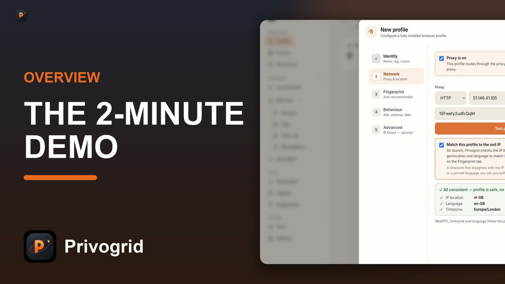

# Privogrid

> The professional privacy browser for multi-account workflows on Windows.

Privogrid is a custom Chromium engine built in C++ for people who manage multiple online accounts on a single PC. Each browser profile has its own real fingerprint, proxy, timezone, and cookie jar — fully isolated.

## Why

Chrome treats every account on the same PC as the same device. Same canvas fingerprint, same WebGL hash, same font list. Platforms link your accounts together automatically.

Privogrid solves this at the engine level — every profile is a completely different "device" from the browser engine's perspective.

## Features

- 🛡 Custom C++ Chromium engine (not an extension, not a JS patch)
- 🎭 Real fingerprint spoofing (canvas, WebGL, audio, fonts, timezone)
- 🌍 Per-profile proxy support (HTTP, HTTPS, SOCKS5)
- ⚡ Bulk create up to 500 profiles in seconds
- 👥 Team sharing with 4 roles (Owner, Admin, Worker, Viewer) + one-click revoke
- ☁ End-to-end encrypted cloud sync with your own passphrase
- 🤖 Local API + MCP integration (Playwright, Selenium, AI agents)
- 🧰 Stealth ad blocker, RPA automation, screen capture
- 🔐 Code-signed Windows installer by WaveLinker OÜ (EU)
- 🧾 GDPR compliant, 7-day money-back guarantee

## Watch the walkthrough

2-minute demo: https://www.youtube.com/watch?v=AgVSZO5t2UI

## Pricing

| Plan | Price | Profiles | Seats |
|---|---|---|---|
| Free trial | 7 days, no card | 3 | 1 |
| Solo | $9/mo | 20 | 1 |
| Pro | $29/mo | 75 | 3 |
| Agency | $79/mo | 250 | 10 |

Yearly billing is half price on every tier. 7-day money-back guarantee on paid plans.

## Download

Windows installer: **https://privogrid.com**

## Links

- Website — https://privogrid.com
- Community (Discord) — https://discord.gg/H7hcpRkFv
- Blog — https://privogrid.hashnode.dev
- Dev.to — https://dev.to/privogrid
- Medium — https://medium.com/@tv.ytchannel.manager

---

Privogrid is made by **WaveLinker OÜ**, Tallinn, Estonia. GDPR compliant.

